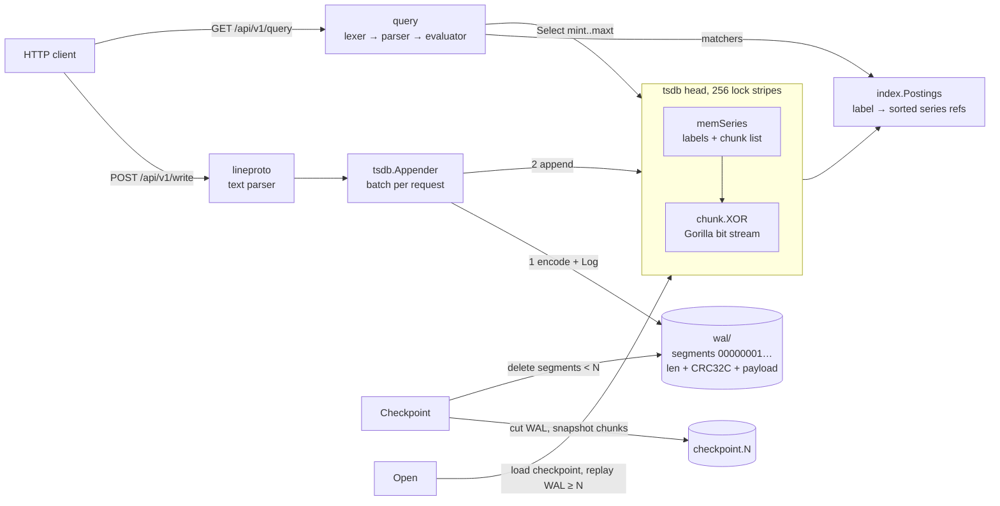

# gorilla-tsdb

A single-node time-series database written in Go. You write metric samples to it over HTTP and query them with a subset of PromQL. Samples are stored in Gorilla-compressed chunks (delta-of-delta timestamps, XOR-encoded floats), protected by a checksummed write-ahead log, and found through an inverted label index.

It has no dependencies outside the Go standard library.

## What it does

- **Ingest**: `POST /api/v1/write` takes Prometheus text-format sample lines (`name{label="v"} value [timestamp_ms]`).
- **Storage**: each series keeps a list of 120-sample Gorilla chunks in memory. Samples whose timestamp is not newer than the series' last sample are rejected.
- **Durability**: every commit goes to a segmented WAL (CRC-32C per record) before it reaches memory. On restart the WAL is replayed. A torn record at the tail of the last segment is dropped; corruption anywhere else is reported as an error.
- **Checkpoints**: a checkpoint writes the compressed head to one file and deletes the WAL segments it covers, which bounds restart time.
- **Retention**: `Truncate` drops chunks older than a cutoff and removes empty series from the index.
- **Query**: a PromQL subset served through `/api/v1/query` and `/api/v1/query_range`. The JSON responses follow the Prometheus HTTP API format:
  - selectors with `=`, `!=`, `=~` and `!~`, plus range selectors such as `[5m]`
  - `rate`, `increase`, `delta` and `irate`. These follow Prometheus' rules for extrapolation and counter resets.
  - `avg/min/max/sum/count_over_time`, `abs`, `ceil`, `floor`, `sqrt`
  - `sum/avg/min/max/count` with `by (...)` or `without (...)`
  - `+ - * /` between scalars and vectors. Vector-to-vector operations match one-to-one on labels.

## Running it

Requires Go 1.22 or newer.

```sh
go test -race ./...                 # all tests
go run ./cmd/gtsdb -data ./data     # server on :9201

# write two samples (timestamps in ms; omit to use server time)
printf 'cpu{host="a"} 1.5\ncpu{host="b"} 2.5\n' | \
  curl -s --data-binary @- localhost:9201/api/v1/write

curl -s 'localhost:9201/api/v1/query?query=sum(cpu)'
curl -s 'localhost:9201/api/v1/query_range?query=sum(rate(cpu[5m]))&start=1700000000&end=1700003600&step=60'
curl -s localhost:9201/api/v1/status
```

Server flags: `-addr`, `-data` (empty means in-memory), `-retention` (default 6h), `-checkpoint-interval` (default 10m) and `-sync-wal` (fsync on every write request).

## Architecture



| package | role |
|---|---|
| `internal/bitstream` | MSB-first bit writer/reader |
| `chunk` | Gorilla encoder/iterator. Timestamp delta-of-deltas go into buckets of 0, 7, 14, 20 or 64 bits; values are XOR-encoded with leading/trailing-zero windows |
| `labels` | sorted label sets, hashing, and the `= != =~ !~` matchers |
| `index` | inverted postings index. Matchers that accept the empty string are applied by subtraction, so `job!="x"` also matches series with no `job` label |
| `wal` | segmented append-only log with torn-tail tolerance and a standalone-file reader for checkpoints |
| `tsdb` | head storage, appender, WAL replay, checkpoints, retention |
| `query` | hand-written lexer, recursive-descent parser with static type checking, and evaluator |
| `lineproto` | ingest text format |
| `server` | HTTP handlers |
| `cmd/gtsdb` | server binary with periodic retention and checkpointing |
| `cmd/tsbench` | workload generator and measurement program |

Design points:

- **Series creation is logged first.** A new series' WAL record is written while its lock stripe is still held, before any other goroutine can see the series. So a sample record can never come before its series record in the log.
- **Checkpoints run while writes continue.** Commits hold a shared lock across "write WAL, then apply to memory". The WAL cut takes that lock exclusively, so every sample in an older segment is already in memory when the snapshot starts. A sample appended during the snapshot can end up in both the checkpoint and the new segment. Replay drops the second copy because its timestamp is not newer than the series' last one, so replay is idempotent.
- **Retention races with appends.** An `Appender` can hold a pointer to a series that `Truncate` deletes. `Commit` finds the deleted flag and resolves the series again (logging a fresh series record), so the WAL never refers to a dead series.
- **Range queries fetch data once.** The evaluator selects each selector's series once for the whole `[start - range, end]` window. Each step then only binary-searches in-memory slices.

## Benchmark results

All numbers below come from one run of:

```sh
go run ./cmd/tsbench
```

The machine was an Apple M3 Ultra (28 cores, `GOMAXPROCS=28`) running Go 1.23.4 on darwin/arm64. The workload was 1000 simulated hosts × 10 metrics = 10,000 series, scraped every 15s for 6h, which is 14,400,000 samples. The data is synthetic and deterministic (fixed seeds). Each host has a constant `up` metric, integer and float counters, integer and decimal gauges, and one uniformly random float series as a worst case. CI runs `go run ./cmd/tsbench -quick`, which uses 100 hosts and 2h of data.

### Compression

Each shape is encoded as 120,000 samples in 120-sample chunks. "vs. 16-byte raw" compares against storing an int64 timestamp plus a float64 value.

| series shape | bytes/sample (exact 15s) | bytes/sample (±3ms jitter) | vs. 16-byte raw (jittered) |
|---|---:|---:|---:|
| constant (up) | 0.41 | 1.25 | 12.8x |
| integer counter (~300/scrape) | 2.50 | 3.33 | 4.8x |
| float counter (cpu seconds) | 6.07 | 6.91 | 2.3x |
| integer gauge random walk | 2.70 | 3.66 | 4.4x |
| gauge, 1 decimal | 5.99 | 6.96 | 2.3x |
| gauge, 2 decimals | 6.77 | 7.73 | 2.1x |
| uniform random float64 | 7.57 | 8.42 | 1.9x |

Timestamp jitter of a few milliseconds costs about one byte per sample. That cost is why the chunk format has a 7-bit delta-of-delta bucket. Before the bucket was added, the same jittered constant series measured 1.99 bytes/sample. XOR encoding works well for repeated values and integers. It does poorly on decimal fractions such as 45.3, because their binary mantissas are long. This is a known weakness of the Gorilla scheme.

### Ingest

There are 28 writer goroutines. Each one owns a slice of the hosts and commits one batch per scrape.

| mode | samples | wall time | samples/sec | head bytes/sample |
|---|---:|---:|---:|---:|
| in-memory (no WAL) | 14,400,000 | 274ms | 52,593,078 | 4.84 |
| WAL, no fsync | 14,400,000 | 912ms | 15,789,112 | 4.84 |

The WAL on disk was 152.1 MiB (11.08 bytes/sample), and the compressed chunk data in memory was 66.4 MiB. The "no fsync" mode means each commit is written to the OS page cache but is not fsynced. This run did not measure `-sync-wal`.

### Query latency

Each query ran 50 times at random times, on a single goroutine, against the 10,000-series head.

| query | expression | p50 | p99 | result series |
|---|---|---:|---:|---:|
| single series, instant | `memory_bytes{host="host-0500"}` | 6µs | 30µs | 1 |
| rate over 1 series, instant | `rate(http_requests_total{host="host-0500",code="200"}[5m])` | 10µs | 20µs | 1 |
| sum by (code) of rate over 2000 series, instant | `sum by (code) (rate(http_requests_total[5m]))` | 5.27ms | 8.81ms | 2 |
| avg by (dc) over 1000 series, instant | `avg by (dc) (load1)` | 3.86ms | 6.11ms | 4 |
| regex host match, max_over_time 10m, 100 series | `max_over_time(temperature_celsius{host=~"host-...1"}[10m])` | 465µs | 1.03ms | 100 |
| 1h range, 1m step, sum of rate over 1000 series | `sum(rate(http_requests_total{code="200"}[5m]))` | 26.55ms | 30.06ms | 1 |
| 1h range, 1m step, 1000 output series | `cpu_seconds_total - 0` | 35.78ms | 41.86ms | 1000 |

### Recovery

| restart from | samples recovered | open time | samples/sec |
|---|---:|---:|---:|
| WAL replay only | 14,400,000 | 1.266s | 11,372,550 |
| checkpoint | 14,400,000 | 424ms | 33,957,963 |

Writing the checkpoint took 107ms (68.6 MiB, 120,000 chunks). In both cases the benchmark checks that the recovered sample count matches what was written.

### Chunk micro-benchmarks

`go test -run='^$' -bench=. ./chunk/`, on the same machine:

| benchmark | result |
|---|---|
| `BenchmarkAppend` (one sample, random-walk gauge) | 26.94 ns/op, 0 allocs/op |
| `BenchmarkIterate` (decode a full 120-sample chunk) | 1415 ns/op, 0 allocs/op |

## Tests

`go test -race ./...` covers:

- bit stream and chunk round trips over 200 randomized seeds. The inputs include NaN, ±Inf, random bit patterns, huge timestamp jumps and every delta-of-delta bucket boundary.
- a check that the index's matcher resolution agrees with a brute-force scan
- WAL segment rotation, recovery from a torn tail at several cut points, and detection of corruption in older segments and in the middle of the final segment
- recovery from the WAL alone, from a checkpoint plus WAL, and after truncation
- retention racing with an appender that already holds the series
- 8 concurrent writers racing a query loop and a continuous checkpoint loop, followed by a reopen that must recover every sample
- query parsing and type errors. Function and aggregation results are checked against hand-computed values, including `rate` with counter resets and the no-extrapolation-below-zero rule, the lookback window, and range queries.
- an HTTP round trip of writes and queries through `httptest`

## Limitations

- **Head only.** All data lives in memory. There are no persistent, compacted, immutable blocks on disk, so retention is limited by RAM. Each checkpoint rewrites the whole head instead of being incremental.
- **No out-of-order ingestion.** A sample older than its series' last sample is dropped and counted. If two appenders write the same series at the same time, the WAL order can differ from the in-memory order, and replay may then drop the sample that arrived out of order.
- **Durability defaults to the OS page cache.** Without `-sync-wal`, a machine crash can lose the commits that were acknowledged most recently.
- **The PromQL subset is partial.** There are no comparison or set operators, no `on`/`ignoring`/`group_left`, no `offset`, subqueries, `topk`/`quantile` or histogram functions. Vector-to-vector arithmetic does not detect many-to-many matches.
- **Query cost.** The evaluator decodes every chunk that overlaps the query window and materializes the samples. There are no query timeouts, concurrency limits or memory limits.
- **No security or clustering.** There is no authentication, no TLS and no replication; it is a single node.
- **The benchmark is synthetic and was run on one machine.** It measures this implementation and does not compare it with other databases.
